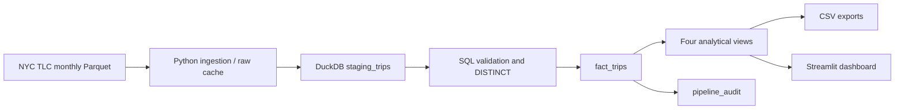

# Architecture

Prefect defines ingestion tasks with retries followed by warehouse construction. The CLI is the demonstrated annual execution path. The dashboard queries the four views read-only. The curated table is rebuilt on each run rather than appended. See `src/transform.py` for the actual executable SQL.
