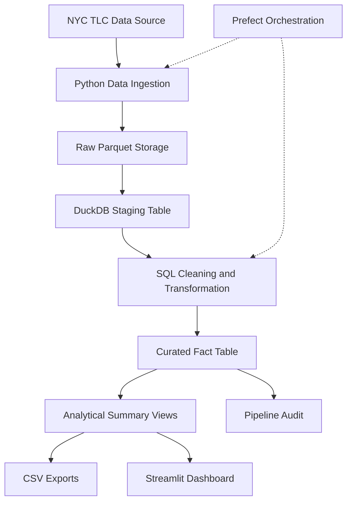
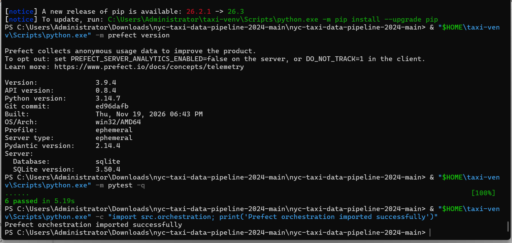

# Designing an End-to-End Data Pipeline for NYC Taxi Trip Data Analytics

**Course:** DSAI5102 — Data Architecture & Engineering  
**Dataset:** NYC Taxi & Limousine Commission (TLC) Yellow Taxi Trip Records  
**Period:** January–December 2024  
**Platform:** Windows 10/11, Python 3.12  
**Technologies:** Python, Parquet, DuckDB, SQL, Prefect and Streamlit

---

## 1. Project Overview

This project demonstrates the design and implementation of an end-to-end batch data pipeline for NYC Yellow Taxi trip records.

The pipeline collects, stores, cleans, transforms and analyzes taxi trip data to provide meaningful insights into transportation patterns throughout 2024.

The project was initially developed using January 2024 as a pilot dataset to validate the architecture, troubleshoot implementation issues and test the transformation logic before expanding to the full calendar year.

### Project Objectives

- Automate the ingestion of monthly taxi trip records.
- Maintain raw data in its original Parquet format.
- Implement data cleaning and validation rules.
- Build an analytical warehouse using DuckDB.
- Implement workflow orchestration using Prefect.
- Develop an interactive Streamlit dashboard.
- Ensure reproducibility through documentation and automated tests.

---

## 2. System Architecture



The pipeline follows a batch-processing architecture that separates raw data ingestion, staging, transformation, analytical storage and visualization.

---

## 3. Technology Stack

| Technology | Purpose |
|---|---|
| Python | Pipeline implementation and automation |
| Parquet | Efficient columnar data storage |
| DuckDB | Analytical database and warehouse |
| SQL | Data cleaning, transformation and aggregation |
| Prefect | Workflow orchestration and retry management |
| Streamlit | Interactive analytical dashboard |
| Pandas | Data manipulation and dashboard integration |
| Pytest | Automated testing |
| GitHub | Version control and project documentation |

---

## 4. Repository Structure

```text
nyc-taxi-data-pipeline-2024/
├── README.md
├── requirements.txt
├── dashboard.py
├── verify.py
├── .gitignore
├── report.pdf
├── presentation.pptx
│
├── src/
│   ├── __init__.py
│   ├── config.py
│   ├── ingestion.py
│   ├── transform.py
│   ├── pipeline.py
│   └── orchestration.py
│
├── tests/
│   ├── test_ingestion.py
│   └── test_transform.py
│
├── sql/
│   └── verify.sql
│
└── docs/
    ├── ARCHITECTURE.md
    └── COMPLIANCE.md
```

The following directories and files are generated automatically when the pipeline runs:

```text
data/
├── raw/
├── processed/
└── taxi.duckdb

outputs/
├── monthly_summary.csv
├── hourly_summary.csv
├── payment_summary.csv
└── location_summary.csv
```

Raw datasets, virtual environments and generated database files are excluded from version control.

---

## 5. Dataset Description

The project uses publicly available NYC Yellow Taxi trip records published by the NYC Taxi & Limousine Commission.

The dataset covers all 12 months of 2024.

### Main Source Attributes

| Attribute | Description |
|---|---|
| tpep_pickup_datetime | Trip pickup timestamp |
| tpep_dropoff_datetime | Trip drop-off timestamp |
| trip_distance | Recorded trip distance in miles |
| total_amount | Recorded total trip amount |
| payment_type | Payment method code |
| PULocationID | Pickup location identifier |

Additional analytical attributes are derived during transformation, including:

- Trip month
- Pickup hour
- Trip duration in minutes

### Official Data Source

https://www.nyc.gov/site/tlc/about/tlc-trip-record-data.page

---

## 6. Installation and Setup

### Prerequisites

- Python 3.12
- Internet connection
- Sufficient disk space for the full-year dataset
- Git, if cloning the repository

### Step 1 — Clone the Repository

Open PowerShell and run:

```powershell
cd $HOME\Downloads

git clone https://github.com/nooralnaimi85-ux/nyc-taxi-data-pipeline-2024.git

cd nyc-taxi-data-pipeline-2024
```

Alternatively, download the repository using:

**Code → Download ZIP**

Extract the ZIP and open PowerShell inside the extracted project folder.

### Step 2 — Create a Virtual Environment

```powershell
python -m venv .venv
```

Set the Python executable:

```powershell
$python = ".\.venv\Scripts\python.exe"
```

### Step 3 — Install Dependencies

```powershell
& $python -m pip install --upgrade pip
& $python -m pip install -r requirements.txt
```

Confirm that the current directory contains:

```text
requirements.txt
dashboard.py
src/
tests/
```

Do not execute the setup commands from the Windows system32 directory.

---

## 7. Running the Data Pipeline

### Option A — Full-Year 2024 Processing

```powershell
& $python -m src.pipeline
```

This command downloads and processes all 12 monthly datasets from January to December 2024.

The first execution may require considerable processing time and disk space.

### Option B — January Pilot

```powershell
& $python -m src.pipeline --months 2024-01
```

This option is useful for development, troubleshooting and initial validation.

### Option C — Selected Months

```powershell
& $python -m src.pipeline --months 2024-01 2024-02 2024-03
```

Processing selected months replaces the existing analytical results with the selected period.

To restore the full-year results, rerun Option A.

---

## 8. Data Cleaning and Transformation

The transformation process applies the following project-specific validation rules:

| Quality Rule | Validation Criteria |
|---|---|
| Missing timestamps | Pickup and drop-off timestamps must be present |
| Timestamp consistency | Drop-off must occur after pickup |
| Trip duration | Greater than 0 and no more than 360 minutes |
| Trip distance | Greater than 0 and no more than 200 miles |
| Total amount | Between USD 0 and USD 10,000 |
| Date validation | Pickup month must belong to the selected 2024 period |
| Duplicate records | Duplicate analytical fact records are removed using DISTINCT |

The pipeline creates or replaces the analytical tables during execution rather than appending duplicate records.

This supports repeatable batch processing and prevents duplication caused by rerunning the pipeline.

The exclusion count combines filtering and deduplication and does not represent a separate count for each quality rule.

---

## 9. Analytical Warehouse

DuckDB is used as the local analytical warehouse.

### Main Database Objects

| Database Object | Purpose |
|---|---|
| staging_trips | Stores ingested source records |
| fact_trips | Stores cleaned analytical trip records |
| pipeline_audit | Stores processing statistics |
| monthly_summary | Monthly trip counts and averages |
| hourly_summary | Trip distribution by pickup hour |
| payment_summary | Trip distribution by payment type |
| location_summary | Top 15 pickup location IDs |

The database is generated at:

```text
data/taxi.duckdb
```

The analytical views support dashboard visualization and CSV exports.

---

## 10. Full-Year Processing Results

The recorded full-year pipeline execution produced the following results:

| Metric | Result |
|---|---:|
| Dataset period | January–December 2024 |
| Months processed | 12 |
| Raw records | 41,169,720 |
| Retained analytical records | 39,809,562 |
| Excluded or deduplicated records | 1,360,158 |
| Data retention rate | 96.70% |
| Exclusion rate | 3.30% |

These figures are based on the recorded full-year execution output.

The reconciliation is:

```text
41,169,720 - 39,809,562 = 1,360,158
```

Independent warehouse verification can be performed using the provided verification script.

---

## 11. Workflow Orchestration

Prefect is used to define the batch workflow and manage task dependencies.

The workflow includes:

1. Downloading the selected monthly datasets.
2. Managing ingestion tasks and retry attempts.
3. Building the analytical warehouse.
4. Applying data cleaning and transformation rules.
5. Generating analytical summaries and CSV exports.

Run the Prefect workflow using:

```powershell
& $python -m src.orchestration
```

The ingestion task supports up to three retries with a delay of 15 seconds between attempts.

The provided workflow supports on-demand execution. A recurring production schedule has not been independently verified.

---

## 12. Interactive Dashboard

The Streamlit dashboard provides interactive visualization of the analytical warehouse.

### Dashboard Components

| Visualization | Purpose |
|---|---|
| Retained trips KPI | Displays the number of curated trip records |
| Monthly trip volume | Compares trip counts across months |
| Hourly pickup pattern | Identifies variation in trips by pickup hour |
| Payment distribution | Compares recorded payment type codes |
| Top 15 pickup locations | Identifies the most frequently recorded pickup location IDs |

### Launch the Dashboard

```powershell
& $python -m streamlit run dashboard.py
```

Open the following address if the browser does not launch automatically:

```text
http://localhost:8501
```

The dashboard reads the analytical views directly from DuckDB.

Payment methods and pickup locations are displayed using their original numeric source codes.

Keep the PowerShell window running while using the dashboard.

Press Ctrl+C to stop the dashboard server.

---

## 13. Automated Testing


## 13. Automated Testing and Verification

The automated test suite was successfully executed on 25 November 2026.

| Verification Metric | Result |
|---|---|
| Total automated tests | 6 |
| Passed tests | 6 |
| Failed tests | 0 |
| Success rate | 100% |
| Execution time | 5.19 seconds |
| Tested Python version | 3.14.7 |
| Prefect version | 3.9.4 |
| Orchestration module import | Successful |
| Operating system | Windows 64-bit |

All automated ingestion and transformation tests passed successfully.

The Prefect installation and orchestration module import were also verified successfully.

Full workflow execution and recurring scheduling remain separate verification activities.

### Testing Evidence



### Test Coverage

- Invalid month format validation
- Invalid month number validation
- January-specific filtering
- Exclusion of records outside the selected period
- Rejection of non-2024 processing periods
- Repeatable processing without duplicate accumulation

Run the tests using:

```powershell
& $python -m pytest -q
```

The current test suite defines six test cases, including parameterized ingestion tests.

The actual pass or fail results should be confirmed by executing the test suite in the configured Python environment.

---

## 14. Warehouse Verification

After completing the full-year pipeline, run:

```powershell
& $python verify.py
```

The verification script checks:

- Raw record count against the staging table.
- Curated record count against the fact table.
- Reconciliation of raw, curated and excluded records.
- Availability of all 12 months.
- Monthly summary totals against the curated fact table.
- Hourly and payment summary totals against the curated fact table.

Additional SQL verification queries are available in:

```text
sql/verify.sql
```

### Inspect Monthly Results

```powershell
Import-Csv .\outputs\monthly_summary.csv | Format-Table
```

### Verify the Number of Months

```powershell
(Import-Csv .\outputs\monthly_summary.csv).Count
```

A successful full-year run with retained records in every month should return:

```text
12
```

---

## 15. Generated Outputs

The pipeline produces the following analytical CSV files:

| Output File | Description |
|---|---|
| monthly_summary.csv | Monthly trip volume, average total amount and average distance |
| hourly_summary.csv | Trip counts by pickup hour |
| payment_summary.csv | Trip counts by payment type |
| location_summary.csv | Top 15 pickup location IDs by trip count |

These files are generated locally in the outputs directory.

The generated database and CSV files are not included in the GitHub repository. They can be reproduced by running the pipeline.

---

## 16. Troubleshooting

| Issue | Recommended Solution |
|---|---|
| Python command not recognized | Install Python 3.12 and configure the system PATH |
| requirements.txt not found | Open PowerShell inside the project root directory |
| ModuleNotFoundError | Install dependencies using requirements.txt |
| Virtual environment access denied | Move the project outside restricted system directories |
| Database not found | Run the pipeline before launching the dashboard |
| Dashboard displays only January | Run the pipeline without the --months argument |
| Streamlit port already in use | Stop the existing Streamlit process or use another port |
| Incomplete download | Retry the pipeline or use the Prefect workflow |
| Insufficient disk space | Free disk space or use the January pilot for testing |

To use an alternative Streamlit port:

```powershell
& $python -m streamlit run dashboard.py --server.port 8502
```

---

## 17. Limitations and Future Improvements

### Current Limitations

- The pipeline operates in batch mode rather than real time.
- Processing the full-year dataset requires sufficient local storage.
- Payment and location codes are not mapped to descriptive labels.
- The data quality audit does not provide individual exclusion counts for every cleaning rule.
- A recurring Prefect production schedule has not been verified.
- Full-year dashboard CSV outputs and current automated test results require additional verification.

### Future Improvements

- Implement incremental monthly processing.
- Configure automated Prefect scheduling.
- Integrate taxi zone lookup data.
- Map payment codes to descriptive labels.
- Add detailed data quality monitoring.
- Introduce geographic visualizations.
- Implement continuous integration for automated testing.
- Explore cloud-based deployment.

---

## 18. Project Deliverables

| Deliverable | Location |
|---|---|
| Technical Report | [report.pdf](report.pdf) |
| Project Presentation | [presentation.pptx](presentation.pptx) |
| Source Code | [src/](src/) |
| Automated Tests | [tests/](tests/) |
| Architecture Documentation | [ARCHITECTURE.md](docs/ARCHITECTURE.md) |
| Compliance Documentation | [COMPLIANCE.md](docs/COMPLIANCE.md) |
| SQL Verification | [verify.sql](sql/verify.sql) |
| Interactive Dashboard | [dashboard.py](dashboard.py) |
| Python Dependencies | [requirements.txt](requirements.txt) |

---

## 19. Reproducibility

The project is designed to be reproducible using the following execution sequence:

```powershell
python -m venv .venv

$python = ".\.venv\Scripts\python.exe"

& $python -m pip install -r requirements.txt

& $python -m pytest -q

& $python -m src.pipeline

& $python verify.py

& $python -m streamlit run dashboard.py
```

The optional Prefect workflow can be executed using:

```powershell
& $python -m src.orchestration
```

All required source code, configuration files and dependency specifications are provided in this repository.

---

## 20. Conclusion

This project demonstrates an end-to-end data engineering solution that transforms raw NYC Yellow Taxi trip records into structured analytical information.

The implementation integrates data ingestion, raw storage, data quality validation, SQL transformation, analytical warehousing, workflow orchestration and interactive visualization.

The recorded full-year execution processed more than 41 million source records and retained approximately 39.8 million analytical records.

The resulting architecture provides a reproducible foundation for transportation data analysis and future data engineering enhancements.

---

## Repository Information

**Project:** Designing an End-to-End Data Pipeline for NYC Taxi Trip Data Analytics

**Course:** DSAI5102 — Data Architecture & Engineering

**Institution:** University of Doha for Science and Technology (UDST)

**Academic Year:** 2026–2027

**Repository:**

https://github.com/nooralnaimi85-ux/nyc-taxi-data-pipeline-2024

---

## Acknowledgments

NYC Taxi & Limousine Commission (TLC) for providing publicly available taxi trip records.

This project was developed for academic purposes as part of the DSAI5102 Data Architecture & Engineering course.
